## Overview

The **Equipment Availability** page shows, at a glance, how much of each product is free to book over a span of dates. It is a planning view over the rental [availability engine](/docs/api/availability): availability is the quantity of a product that is free at a store at a given time, where `available = total stock − total demanded`, and may go **negative** when demand exceeds stock — a shortage.

**Route:** `/availability`

The page lives under the **Job Planning** section of the navigation (the "Equipment Availability" link) and is gated on the `availability.view` permission. It is read-only — it reflects bookings made on opportunities elsewhere; it does not itself create demand.

The primary view is **By Product Group** — a products-by-days grid scoped to one catalogue group. Clicking a product name or cell opens the **Product Bookings** drill-down for that product. Store, date, group, and filter state are persisted in the URL so a link reopens exactly as shared.

## By Product Group

The **By Group** view is the landing view. It shows a **products-by-days grid** for the selected product group, making it the fastest way to check whether your lighting stock, audio stock, or any other category has room in a window.

The grid is tightened so **30 days fit on load** without horizontal scrolling on typical screens. Table text uses a softer sans-serif stack for long planning sessions.

### Controls

| Control | Effect |
|---------|--------|
| **Stores** | Multi-store tag-input (Signals tag-input). Empty = all in-default-query stores; availability and stock are **summed across** the selected stores via `AvailabilityService::getCalendarForStores` and `productTotalStockForStores`. Uses `PlanningStoreFilter`. |
| **Product Group** | The group whose products fill the rows. Required — select a group to populate the grid. |
| **Product type** | Filter rows to Rental or Sale products, or show all. |
| **Start date** | The first day of the window. Signals datepicker. |
| **Days** | The window length: 7, 14, 28, 30, or 60 days. Default 30. |
| **Shortages only** | Toggle — hide rows with no shortage cell in the window. |
| **Warnings only** | Toggle — hide rows with no warning (low-but-positive) cell in the window. |
| **Include quotes** | Toggle — whether provisional (quotation-stage) demand counts towards held (UI present; read-model filter pending). |

Previous/next buttons step the window by one full period length.

### Reading the grid

Each row is a product in the group; each column is a day. Cells are colour-coded by availability state:

| Colour | Meaning |
|--------|---------|
| Green | Available — comfortably in stock for this day. |
| Amber | Warning — low but still positive (2 units or fewer remaining). |
| Red | Shortage — demand exceeds stock (`available ≤ 0` with a shortage). |
| Cyan | Booked — every unit is committed but nothing is oversold (available = 0, no shortage). |

Each cell shows **`available (held)`** — the free quantity and, in parentheses, how much of the total stock is committed. Weekend columns are shaded.

Clicking a **product name** or cell opens **Product Bookings** for that product, carrying forward the current store selection, start date, and day count.

Rows are paginated (20 per page) for large groups.

### Layout chrome

- **Sticky filter bar** — page header and filters stay pinned while scrolling.
- **Sticky day headers** — column labels remain visible above the grid body.
- **Loading skeleton** — deferred first paint skeleton before availability data loads.

A **colour legend** below the grid explains cell states. **Delivery / In-Use / Collection** phase colours appear on the Product Bookings drill-down (see below), shared via `OpportunityPresentation`.

## Product Bookings

**Route:** `/availability/bookings/{product}/{from}/{days}`

The **Product Bookings** page (Current RMS "Product Bookings") focuses on a **single product** over a date window. It reuses the same grid chrome as the By Group view.

### Summary rows

At the top of the grid, three summary rows show per-day figures across the window:

| Row | Content |
|-----|---------|
| **Available** | Colour-coded free quantity per day (same green/amber/red/cyan rules as the group grid). |
| **Held** | Total stock minus available — how much is committed. |
| **Post-rent** | Pending check-in quantity (returned but not yet cleared). |

### Opportunity rows

Below the summaries, **one row per opportunity** (for bulk / non-asset demand) shows which days that booking claims stock. Cells use **Delivery / In-Use / Collection** phase colours from `OpportunityPresentation` so you can see not just *when* a unit is on hire but which part of the RMS lifecycle each day falls in. Row labels link to the opportunity detail page.

### Asset rows

For **serialised** products, **one row per asset** (asset number) follows the opportunity rows. Assets are **store-scoped** — only assets at the resolved store(s) appear. Each cell shows phase-coloured demand for that specific asset on that day.

When multiple stores are selected on the group grid, the bookings page inherits that selection and aggregates summary figures; asset rows list assets from all resolved stores.

### Navigating to bookings

From the By Group grid:

- Click the **product name** in the row label, or
- Click any **day cell** in that row.

The URL carries `product`, `from`, `days`, and optional `stores[]` query parameters.

## Shortages

Where committed demand exceeds stock, availability dips below zero. Use **Shortages only** on the group grid to focus on affected products, or open Product Bookings to see which opportunities and assets contribute to a short day. Shortages are detected and resolved per opportunity on the [Shortages panel](/docs/platform/shortages); the availability pages are where you spot them across the wider plan.

## Live Updates

The By Group page is **live**. It subscribes to each resolved store's `availability.store.{storeId}` broadcast channel, so when a booking, return, resolution, or stock movement changes the picture, the grid re-reads authoritative figures without a manual refresh.

## Request-local availability reads

The availability read path uses request/job-scoped memoization for identical
read facts. Product lookups and store timezone lookups are reused only for the
current Laravel request or job; global scopes, soft-delete behavior, timezone
fallbacks, and availability query semantics remain unchanged. No persistent
cache is used.

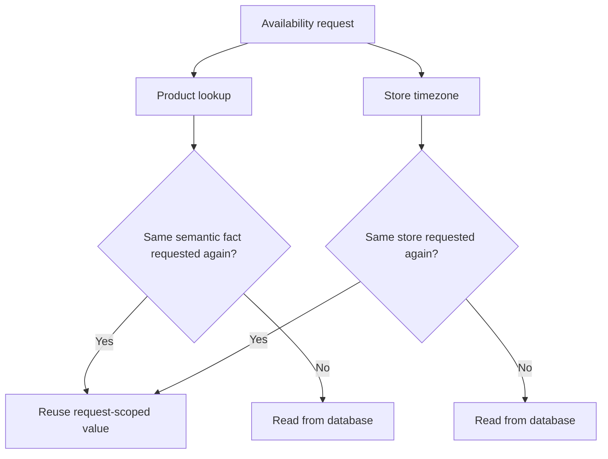

Stock and demand calculations are not memoized across mutable operations. In
particular, different demand windows remain separate facts, and stock reads
continue to execute when the pipeline is used after a same-request stock
mutation.

### Phase 3A stock/window separation

Within one `AvailabilityService::availableForItems()` evaluation, stock and
demand now use their own semantic grouping:

- stock is keyed by `product_id + store_id`; it is independent of the booking
  window;
- demand is keyed by `product_id + store_id + from + to` and keeps the existing
  active/overlap filters;
- each result still applies its own opportunity-item demand exclusion;
- this is orchestration only: no cache, memoization, or availability snapshot
  is introduced.

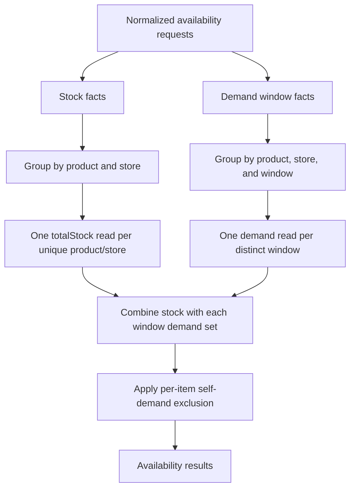

### Phase 3B cross-opportunity peer detection (IMPLEMENTED)

Cross-opportunity peer discovery now batches shortage detection by peer
Opportunity. The scanner preserves the original peer selection and output order,
while each valid Opportunity group is passed through the existing
`ShortageDetector::forItems()` path.

The Opportunity boundary is intentional: `forItems()` binds one Opportunity
context to every item in its input. Grouping peers from different Opportunities
together would change their source identity and date/store context. Within one
Opportunity batch, Phase 3A groups stock by product/store and demand by
product/store/window; each item still excludes only its own demand.

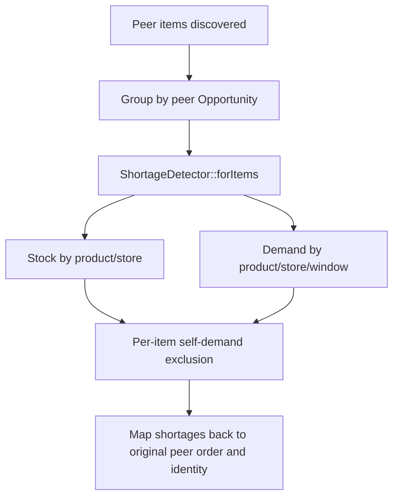

No resolver candidate batching, memoization, snapshot, or persistent cache is
introduced by this phase.

### Phase 3C resolver candidate availability (IMPLEMENTED)

Date-shift and warehouse-transfer resolvers now build all candidate availability
requests for one resolver evaluation before calling the existing bulk availability
API.

- Date-shift candidates are mapped by offset and shifted window. Stock is shared
  by product/store while demand remains distinct per shifted window.
- Warehouse-transfer candidates are mapped by target Store ID. Stock and demand
  remain Store-specific, and the source Store remains excluded.
- Candidate ordering and option metadata are built from the original candidate
  collections after results are mapped back explicitly.
- No resolver interface, memoization, snapshot, or persistent cache was added.

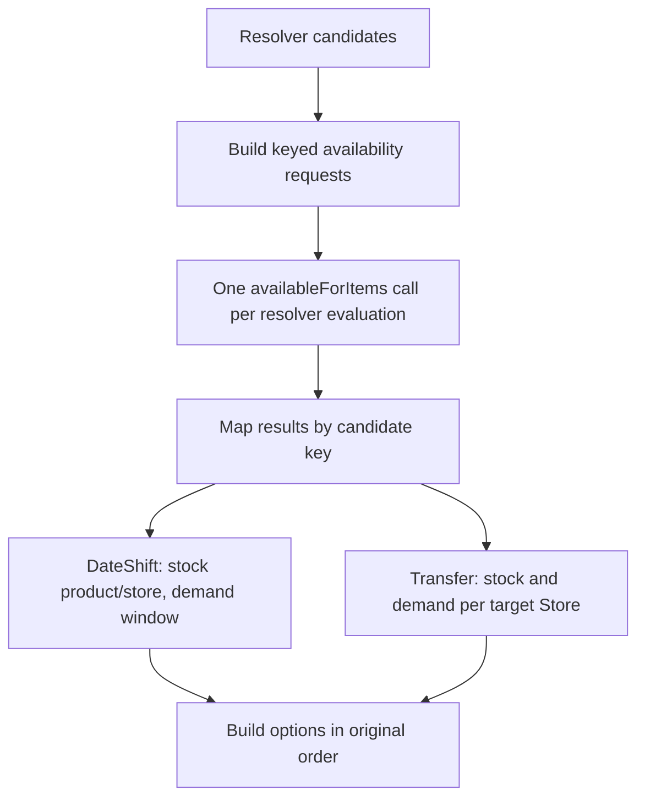

### Phase 3E shared stock fact context (IMPLEMENTED)

The read-only Opportunity Shortages workflow creates one explicit
`StockReadContext` for its local detection, peer detection, and resolver option
generation. The context contains only raw `totalStock()` results keyed by
`product_id + store_id`.

Demand collections are not shared. Demand remains independently evaluated by
`product_id + store_id + booking window` with the existing per-item
self-demand exclusion. The context is a local PHP object for one read flow;
it is not stored on Livewire state, a service, the container, or persistent
cache. A later read flow therefore performs a fresh stock read.

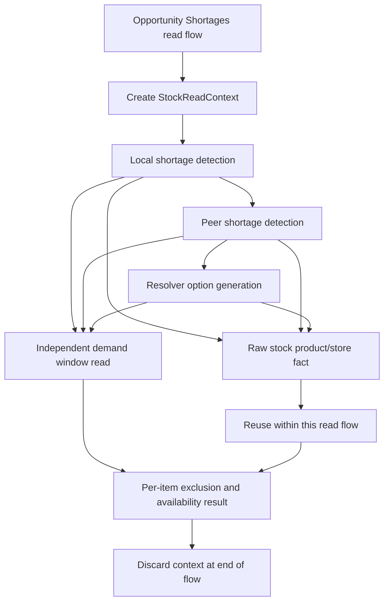

### Phase 3F shared raw demand fact context (IMPLEMENTED)

The same shortages read flow also creates a separate `DemandReadContext` for
raw demand collections. Its complete key is:

    active-overlap + product_id + store_id + normalized from + normalized to

Only the raw `Demand` collection is shared. Each availability result receives a
new collection wrapper and independently applies its own self-demand exclusion.
Filtered collections and final availability values are never stored in the
context.

Different windows, Stores, or query modes remain separate keys. The context is
read-only and exists only for the current local/peer/resolver evaluation; it is
not Livewire state, service state, persistent cache, or cross-request memory.

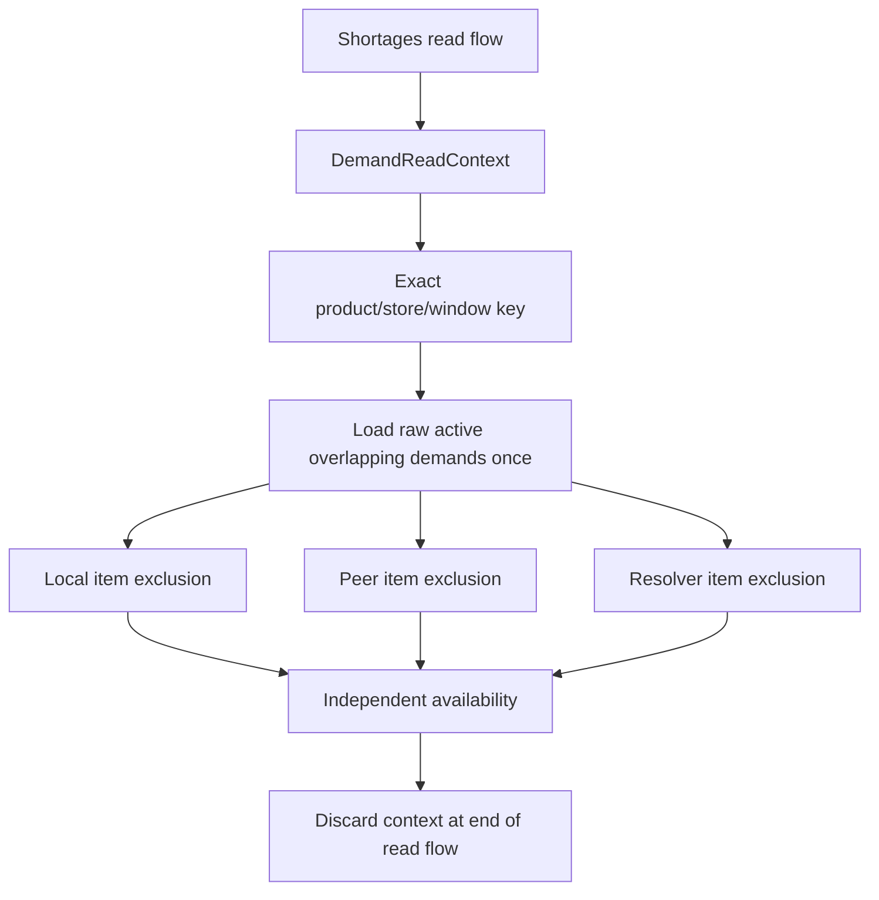

### O2C.2 nested line-items Product/context preparation (IMPLEMENTED)

The nested `opportunities.line-items` Livewire component is an independent read
boundary. For each fresh component read it loads the canonical active-version
OpportunityItems once, resolves passive read-only item contexts once, and collects
the already-loaded Product rows into a passive `PreparedProductInputs` map.

The prepared item contexts and Product inputs are passed explicitly to the
TreeBuilder, PlanningReader, AvailabilityService, and OwnedCapacityReader paths.
Prepared inputs never query the database and missing Product input is an explicit
invariant failure on the prepared path; there is no cache, memoization, or lazy
read-through fallback. The parent Opportunity Show component and its action/guard
flow remain separate. Stock and Demand are still independently evaluated and are
not propagated by O2C.2.

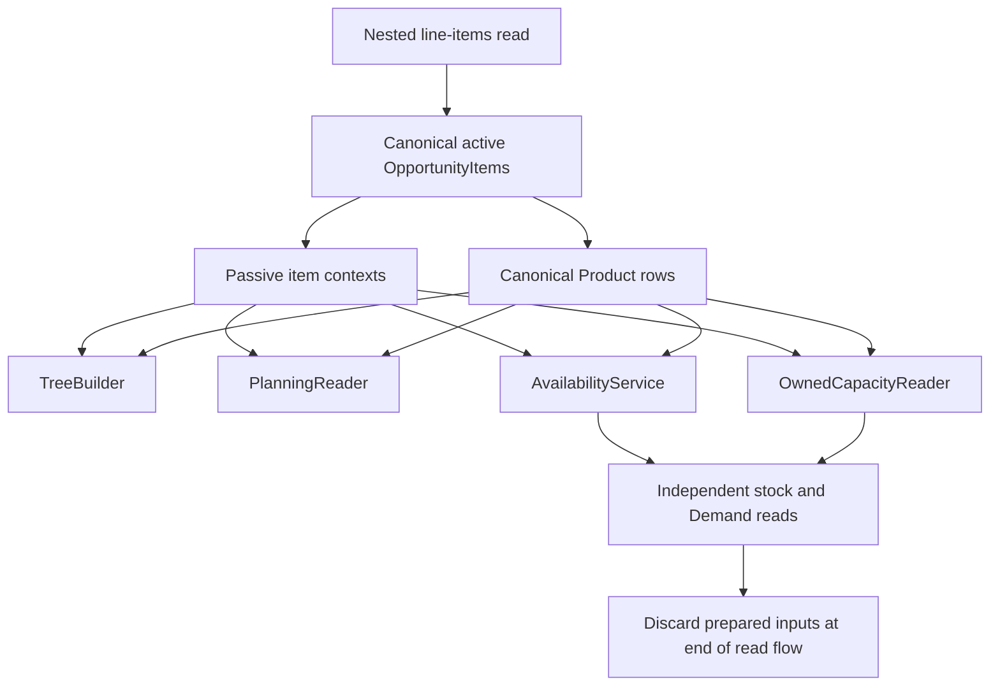

Future from the O2C.2 boundary:

- Parent action/guard integration — a separate phase.

### O2C.3 nested line-items raw stock propagation (IMPLEMENTED)

The nested line-items read preparation now collects the unique standard stock keys
from the prepared item contexts and evaluates `RecalculationPipeline::totalStock()`
once per `product_id + store_id`. The resulting scalar values are held in the
passive, query-free `PreparedStockInputs` input and passed explicitly to
AvailabilityService, OwnedCapacityReader, PlanningReader, and the TreeBuilder
availability path.

This is explicit data propagation, not a cache: there is no memoization, `once()`
stock lookup, lazy resolver, or fallback query on the prepared path. A fresh
line-items read prepares fresh stock facts. Product/store keys remain distinct.
Specialized Demand remains independently evaluated; standard raw Demand propagation
is implemented in O2C.4 below.

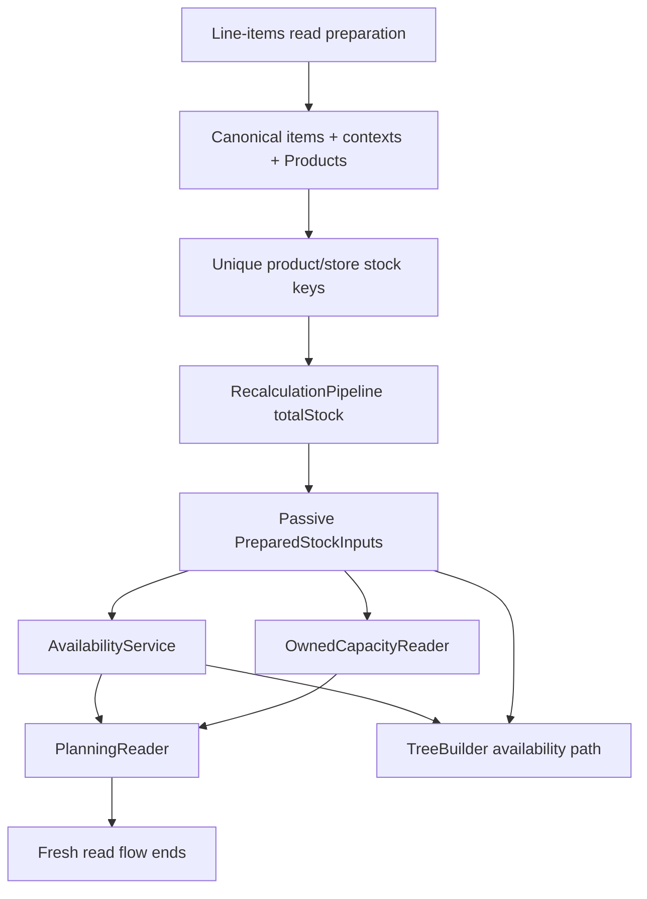

### O2C.4 nested line-items raw standard Demand propagation (IMPLEMENTED)

The nested line-items preparation now collects each unique standard Demand semantic
key and loads its raw active overlapping rows once. The complete key includes the
query mode, Product, Store, and normalized UTC window. The passive
`PreparedStandardDemandInputs` contract returns a fresh collection wrapper to each
consumer.

Only the raw overlap collection is shared. AvailabilityService and
OwnedCapacityReader independently apply their own self-demand exclusion and retain
their distinct calculations. Filtered Demand, final availability, owned capacity,
shortages, and specialized virtual/external-supply Demand are not shared. There is
no cache, memoization, lazy fallback, or cross-request state; a fresh line-items
flow reloads Demand.

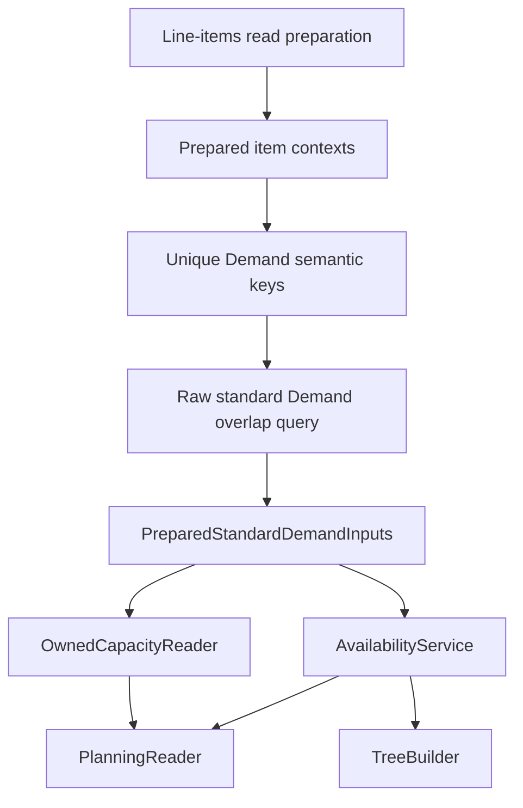

### O2C.5 PlanningReader shortage-input propagation (IMPLEMENTED)

`OpportunityItemPlanningReader` now propagates the prepared Product, stock, and
standard Demand inputs into `ShortageDetector::forItems()` during the nested
line-items read flow. Shortage detection retains ownership of shortage quantity,
allocation, resolution, and exclusion semantics; it only receives the already
prepared raw inputs instead of re-entering Product/stock/standard-Demand loading.

The prepared path remains explicit and query-free on missing input: a missing
Product, stock key, or standard Demand key raises an invariant error instead of
falling back to a database query. Legacy callers without prepared inputs retain
their existing self-loading behavior. The parent Opportunity action/shortage
flow remains independent.

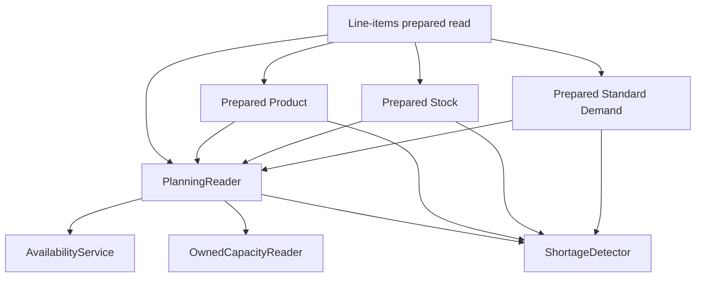

### O2C.8 Child shortage summary projection (IMPLEMENTED)

The nested line-items Livewire component already computes the per-item shortage
projection while building planning data. It emits only the derived unresolved count
to the parent Overview component:

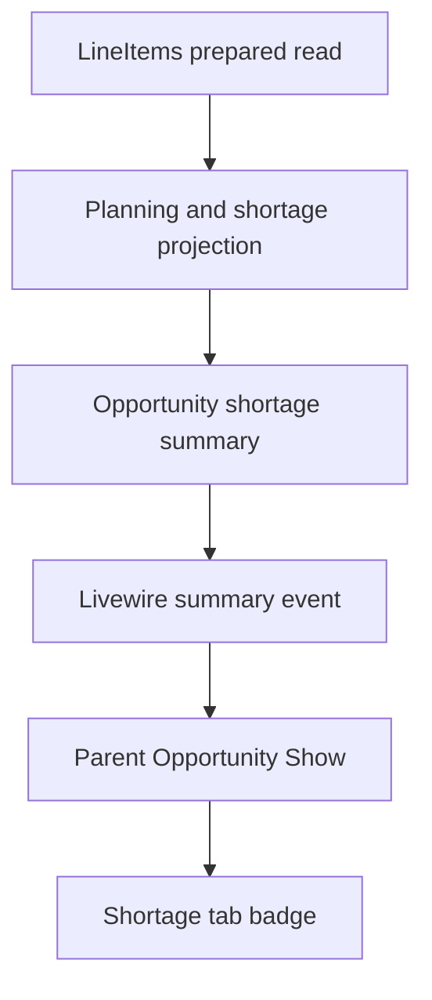

Only `opportunity_id` and `unresolved_count` cross the component boundary. Product,
stock, Demand, availability, and full shortage data remain inside the child read flow.
The parent badge no longer runs the full `ShortageDetector`; command-time validation
and the dedicated Shortages tab remain unchanged. This is explicit derived-state
propagation, not caching or memoization. A fresh child read emits a fresh summary,
including after availability refreshes.

### Phase 2 mutation boundary

The mutation audit covers stock-level writes, Asset lifecycle transitions,
Demand observers/resolvers, virtual stock, repairs, containers, stock
transactions, and supplier-cost actions.

Stock and demand overlap facts remain uncached because their same-request
mutation paths are broader than one safe invalidation seam. This avoids stale
availability after a stock or demand mutation.

Supplier-cost candidate reads are memoized by:

    product_id + store_id

The supplier-cost query object is scoped to the request/job. Supplier-cost
writes occur through separate actions and are not part of the shortage read or
apply operation, so no cross-request state is retained.

Warehouse transfer Store lists are memoized by the excluded source Store ID.
The resolver is request/job scoped and the shortage read path does not mutate
the Store universe.

    Read fact
      -> cache miss -> canonical database query -> scoped request/job state
      -> cache hit  -> reuse scoped result

    Stock or demand mutation
      -> remains uncached in this phase

## The Resolution Setting

Availability is bucketed into time slots whose granularity is set by the **availability resolution** setting — **daily**, **half-daily**, or **hourly**. The resolution determines how finely the underlying snapshots divide time, and dates are aligned to the slot boundary in the store's local timezone. Daily resolution suits most dry-hire operations; finer resolutions suit same-day turnarounds where intra-day timing matters.

> **Note:** Kit and composed products do not hold their own daily summary rows — their availability is derived at read time from their components. They therefore do not appear in the group grid; query a kit's components directly, or use the [availability API](/docs/api/availability) for a live read.

## Related

- [Availability API](/docs/api/availability) — point and range availability reads, calendar aggregation, Gantt demand decomposition, and the available-assets endpoint.
- [Job Planner](/docs/platform/planner) — overlap timeline of jobs across the same window.
- [Opportunities](/docs/platform/opportunities) — where demand is created.
- [Shortages](/docs/platform/shortages) — detecting and resolving shortfalls.
