## Overview

**Containers** group serialised assets into dispatchable units — lighting kits, road cases, hybrid kits, and transport boxes. The lifecycle covers configuration, pack/unpack, seal/unseal, dissolve, dispatch, return, and repack.

Warehouse UI routes:

| Route | Purpose |
|-------|---------|
| `/containers` | Container index |
| `/containers/{container}` | Detail and status |
| `/containers/{container}/pack` | Pack UI |
| `/containers/{container}/repack/{opportunity}` | Repack-on-return for an opportunity |

Product-level **container templates** configure default pack lists and policies at `/products/{product}` (container config tab) and via `GET/PUT /api/v1/products/{product}/container_template`.

## Container modes

| Mode | Behaviour |
|------|-----------|
| **Kit** | Contents held from individual availability as a unit |
| **Hybrid** | Mixed fixed/variable contents |
| **Transport** | Road case / flight case; supports **dissolve-on-dispatch** |

## Lifecycle

```
open → sealed → dispatched → returned → (repack) → open
```

| Event | Description |
|-------|-------------|
| **Pack / unpack** | Add or remove serialised items while **open** |
| **Seal / unseal** | Lock container with compliance manifest |
| **Dissolve** | Manual dissolve with warn-and-resolve for nested packing |
| **Dissolve-on-dispatch** | Transport mode — container dissolves when dispatched |
| **Dispatch / return** | Kit dispatch and kit return tie container to an opportunity |
| **Repack-on-return** | Editable scan mode repack after return |

Temporary containers can be created ad hoc for one-off jobs (`POST /api/v1/containers/temporary`).

## Compliance manifest

Sealed containers carry a **compliance manifest** listing packed serial numbers. Retrieve via `GET /api/v1/containers/{container}/compliance`.

## Dissolve-on-dispatch

Transport containers configured for **dissolve-on-dispatch** unpack their contents into the dispatch workflow automatically — the container record completes while assets move to the opportunity.

## Repack-on-return

After kit return, **repack-on-return** lets operators scan items back into the container (`POST /api/v1/containers/repack/start` and per-item repack). UI trigger at `/containers/{container}/repack/{opportunity}`.

## Plugin and webhook seams

Container pack, seal, dissolve, dispatch, return, and repack events appear in the **webhook catalogue** for integrations (barcode scanners, WMS, etc.).

## Using it in the app

### Navigation

| Screen | Route | Nav | Gate |
|--------|-------|-----|------|
| Containers index | `/containers` | Warehouse → Containers ("Cases, flightcases & kits") | `containers.view` |
| Container show | `/containers/{container}` | — | `containers.view` + store |
| Pack | `/containers/{container}/pack` | — | `containers.pack` |
| Repack | `/containers/{container}/repack/{opportunity}` | — | `containers.create` + `opportunities.edit` |
| Product container config | `/products/{product}/container-config` | Product tab (serialised products) | View all; save needs `containers.manage_templates` |

### Product container config tab

**Tab:** Container Config (serialised products only)

| Field | Purpose |
|-------|---------|
| Containerable | Whether the product can act as a container |
| Availability Mode | Kit / Hybrid / Transport behaviour |
| Check-in Mode | How returns are processed |
| Max Nesting Depth | Nested container limit |
| Repack on Return | Enable repack workflow after kit return |
| Warehouse Addable at Dispatch | Allow adds during dispatch |
| Warehouse Add Default Charge | Default charge for warehouse adds |
| Template Slots | Product, quantity, binding for default pack list |

**Save Container Config** requires **`containers.manage_templates`**. Without it the form is view-only with a warning banner.

### Containers index

**Scan barcode** field resolves an existing container or housing — may navigate to show, open pack, or start repack.

**Filters:** search, store, mode chips (Transport / Kit / Hybrid), status chips (defaults to Active)

**Table:** Barcode, Name, Status, Mode, Store, Type (Temporary / Product-backed), Items

Scan-create and repack-from-return flows require **`containers.create`** and **`opportunities.edit`** respectively.

### Pack page

**Route:** `/containers/{container}/pack`

Scan-to-pack workflow while the container is **open**:

- **Strict checklist** vs **free list** scan modes (configured on the container)
- Inline **conflict dialog** when a scan hits an asset already elsewhere — options include transfer, auto-return, and nesting resolution
- **Seal** when packing is complete

### Container show

**Actions** (each policy-gated): Pack items, Repack session, Seal, Dissolve, Unseal (requires reason), Dispatch (kit/transport), Return kit, Verify check-in, Transfer items, Save scan mode

**Panels:** barcode, status, mode, check-in mode, scan mode, store, **contents tree**, **audit timeline**

**Dissolve-on-dispatch:** transport containers configured for this mode dissolve automatically when dispatched from an opportunity — contents move to the dispatch workflow; the container record completes.

**Seal / unseal:** sealed containers carry a compliance manifest; unseal prompts for a reason.

### Repack-on-return

**Route:** `/containers/{container}/repack/{opportunity}`

Editable scan mode after kit return — scan items back into the container with lineage preserved. Also reachable from the index scan box ("start repack from return" modal).

### Opportunity Assets tab

**Route:** `/opportunities/{id}/assets` (visible for Order or Quotation+Reserved)

Sub-tabs: Functions, Allocate, Prepare, Book out, Check in

| Workflow | Container behaviour |
|----------|---------------------|
| Dispatch | Transport dissolve-on-dispatch; kit dispatch ties container to opportunity; amendment modal for held items under WarnPartial policy |
| Verify check-in | Post-return verification on kit containers |
| Repack split view | Shows repack progress with lineage after return |

**Set container** (bulk Functions menu) assigns containers to opportunity lines. Dispatch and return reuse the same container policies as standalone container pages (`containers.dispatch`, `containers.return`, plus **`opportunities.edit`**).

### Permissions summary

| Permission | UI effect |
|------------|-----------|
| `containers.view` | Index, show, Warehouse nav link |
| `containers.create` | Temporary containers, repack sessions |
| `containers.pack` | Pack page |
| `containers.seal` / `dissolve` / `transfer` | Show page actions |
| `containers.dispatch` / `return` | Dispatch/return (also needs `opportunities.edit` on opportunity) |
| `containers.manage_templates` | Product container config save |
| `opportunities.edit` | Assets tab mutations, repack |

## Related documentation

- [Containers API](/docs/api/containers) — full REST lifecycle
- [Stock Levels](/docs/platform/stock-levels) — serialised asset inventory
- [Opportunities](/docs/platform/opportunities) — dispatch and return on order lines

## Domain authority and containment boundaries

The following distinctions are part of the current domain contract:

| Concept | Authority | Meaning |
|---------|-----------|---------|
| Owned physical quantity | `StockLevel.quantity_held` and `StockTransaction` | How much inventory the company owns at a Store |
| Serialized Container membership | Active `ContainerItem` rows | Which serialized StockLevel is currently housed by a Container, with packing history |
| StockLevel containment projection | `StockLevel.container_stock_level_id` | Current StockLevel/availability relationship to a serialized housing StockLevel |
| Default Container contents | `Product.container_template` | Product-level expected slots and policies |
| Actual serialized contents | Active `ContainerItem` rows | Current serialized membership, not the product template |

Packing inventory into a Container changes physical grouping. It does not
create a stock transaction and does not reduce `quantity_held`. This distinction
is important for both availability and future reconciliation workflows.

## Current Container creation

Product-backed Containers are currently created from an existing serialized
housing StockLevel whose Product is marked `is_containerable`. The canonical
identity chain is:

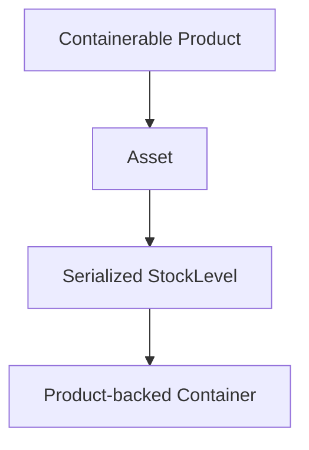

The normal Containers UI still supports this workflow by scanning the housing
Asset number, serial number, barcode, or StockLevel identifier. H1.2 also adds
the standalone durable onboarding page for a new physical housing identity.
The API product-backed create endpoint continues to require
`serialised_item_id`; the UI onboarding path uses the semantic
`CreateDurableContainer` orchestration Action instead.

Temporary Containers are intentionally different. They are barcode-only
operational groupings and do not require a Product, Asset, or StockLevel. The
temporary API is appropriate for an ad-hoc pallet, shipping box, or similar
operational grouping; it is not the durable onboarding path for owned physical
Container equipment.

## H1 durable Container onboarding — implemented

> H1 status: the backend orchestration and operator form are implemented. The
> hybrid containment design remains future work and is documented separately.

The durable onboarding workflow should complement the existing scan-to-create
workflow rather than replace it:

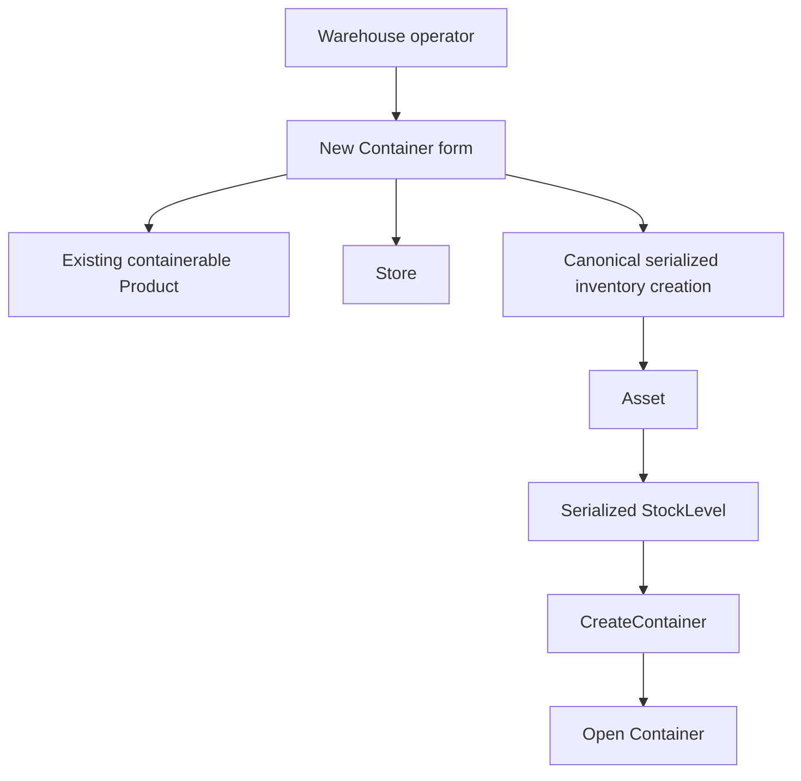

`CreateDurableContainer` now orchestrates existing Product, serialized
StockLevel, Asset, and Container actions inside one transaction. It does not
duplicate Asset, StockLevel, or Opening StockTransaction creation rules.
Durable onboarding is authorized by `containers.create` plus access to the
selected Store; direct StockLevel creation remains protected by
`stock.adjust`.

The H1.1 backend workflow is implemented. The `Warehouse → Containers → New
Container` form is implemented by H1.2. It collects Product, Store, and
physical identity fields, then delegates to `CreateDurableContainer`.
Product filtering and the visible Store list improve usability only; the
backend Action remains authoritative.

The existing path remains valid:

```text
existing serialized housing Asset
    → Containers scan page
    → CreateContainer
    → Pack page
```

## Hybrid containment design foundation — proposed, not implemented

`ContainerItem` currently has a deliberately narrow meaning: one serialized
StockLevel membership. It should not be changed into a nullable polymorphic row
with either `serialised_item_id` or a bulk quantity. That would weaken the
existing one-active-membership invariant and make serialized packing code
interpret several incompatible states.

Future bulk containment should therefore use a separate explicit bulk
membership model, for example `ContainerBulkMembership`, referencing the exact
bulk `StockLevel` and carrying an active quantity. Its history should record
pack, partial unpack, transfer, and dissolve operations without becoming an
ownership ledger.

The ownership rules remain:

```text
StockTransaction / StockLevel.quantity_held
    = total owned quantity

ContainerBulkMembership.quantity
    = quantity currently grouped in this Container

loose quantity
    = quantity_held - sum(active ContainerBulkMembership.quantity)
```

For example:

```text
XLR 5m StockLevel.quantity_held = 100

CASE 01 = 20
CASE 02 = 20
CASE 03 = 10
loose   = 50
```

No `StockTransaction` is created by these containment changes.

Bulk packing must lock the exact bulk StockLevel, calculate active
containment, reject a result above `quantity_held`, and commit the membership
change and its history atomically. All bulk containment writers must use the
same lock boundary; otherwise two concurrent packs could over-assign the same
loose quantity.

Product templates remain the authority for default contents. Actual contents
come from active membership rows. Template differences are compliance or
reconciliation evidence; they must not mutate the template or owned stock
automatically.

## Future workflow boundaries

The following boundaries are intentional:

- D3 stocktake records physical observations and must not infer all contents
  from scanning a Container.
- D5 interprets inventory discrepancies and may later decide whether an
  inventory correction is justified.
- D6 owns Container manifest/container reconciliation, including any future
  verified-container scan workflow.
- Availability integration for bulk contents in dispatched, sealed, kit, or
  hybrid Containers requires an explicit future contract. Containment alone
  must not silently change availability.

Bulk contents inside Containers are therefore not currently implemented by
this documentation update.

## H1.1 workflow diagrams and authority trees

The implemented H1.1 backend workflow is:

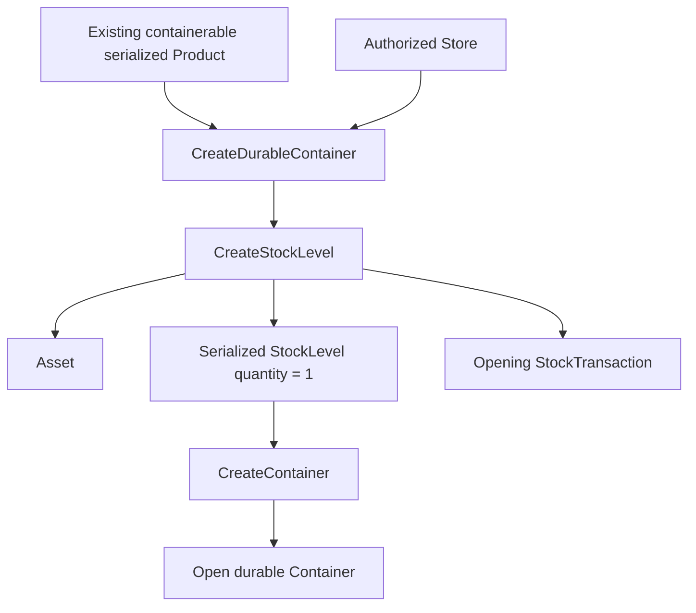

Its failure boundary is:

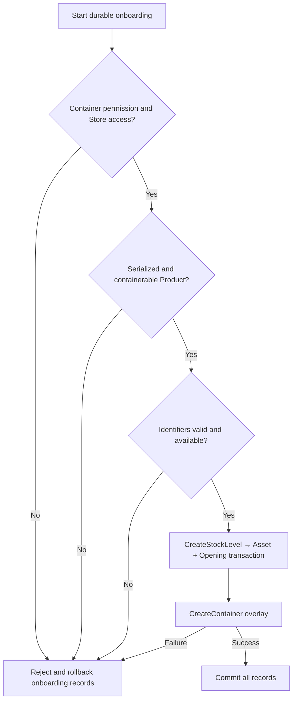

The existing Asset-to-Container overlay path remains separate:

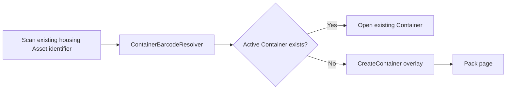

Durable and temporary Containers remain different workflows:

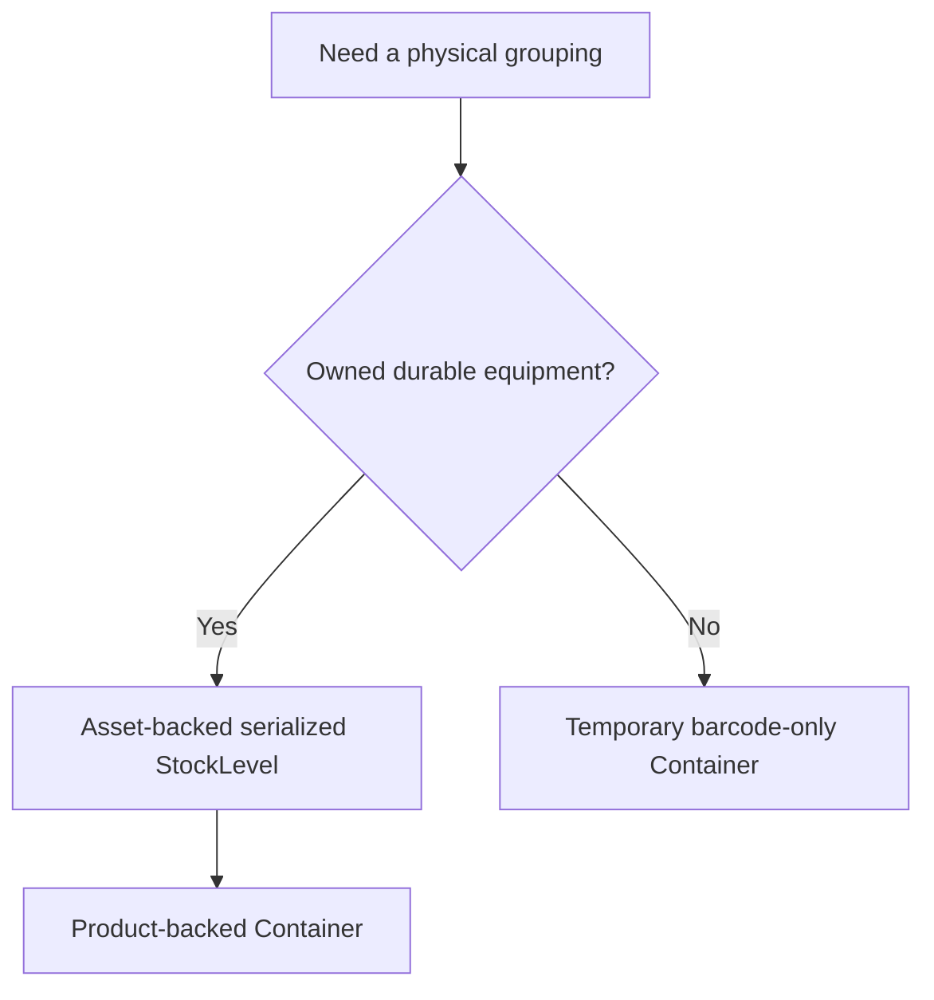

The authority tree is:

```text
Durable Container
├── Product
│   └── existing serialized, containerable definition
├── Asset
│   └── one durable physical identity
├── StockLevel
│   ├── Store
│   ├── quantity_held = 1
│   └── Opening StockTransaction from CreateStockLevel
└── Container
    ├── UUID / barcode
    ├── lifecycle
    └── packing overlay
```

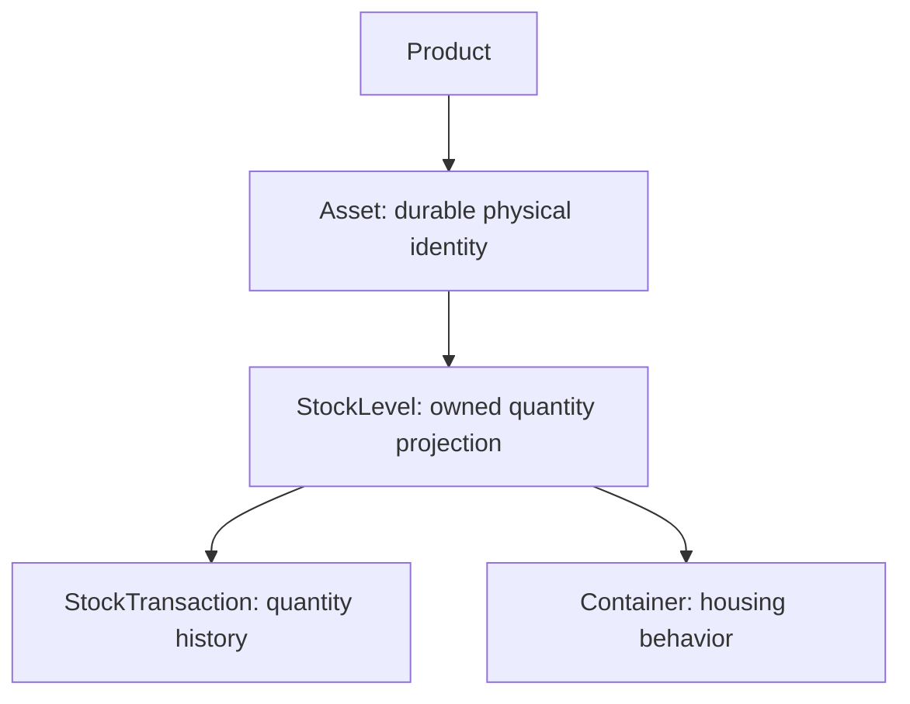

Container creation adds housing behavior but does not add another quantity
mutation:

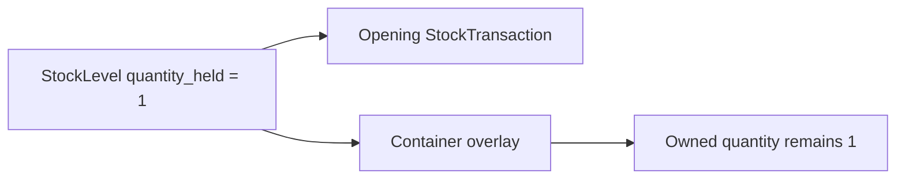

The backend implementation is complete for H1.1. The operator form and
navigation entry point are implemented by H1.2 below.

## H1.2: Durable Container onboarding (implemented)

The Containers index exposes **New durable Container** to users who can
create Containers. The page is a compact operational onboarding form, not
generic Container CRUD. It collects the Product, Store, and physical
identifiers, then delegates the complete workflow to
`CreateDurableContainer`.

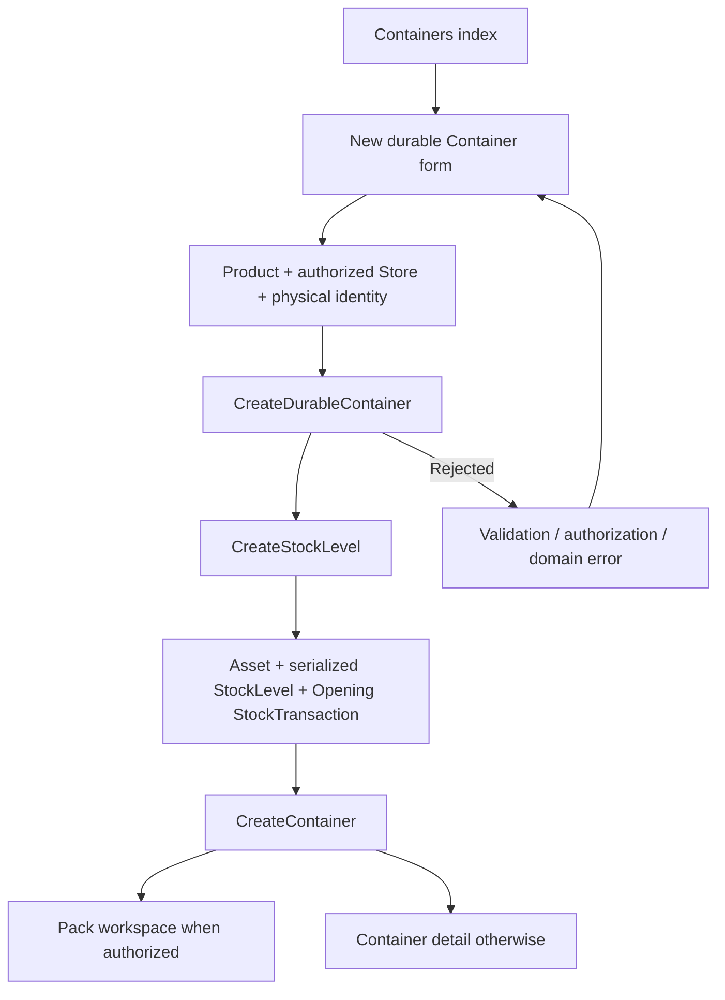

The page anatomy is:

```text
New Durable Container
├── Header
├── Container Type
│   └── searchable Product
├── Location
│   └── Store
├── Physical Identity
│   ├── Asset Number
│   ├── Serial Number
│   └── Barcode
├── Container Details
│   └── Container Name
└── Actions
    ├── Cancel
    └── Create Container
```

The Product search is a usability filter for active, serialized,
containerable Products. The backend Action remains authoritative. The
Store list is narrowed to the current user's accessible Stores, but the
Action still checks concrete Store access so a crafted Livewire request
cannot create inventory in another Store.

The form preserves entered values when validation or domain validation
fails. Identifier collisions are mapped to the relevant operator field.
On success, the operator is sent to the existing Pack workspace when the
user has pack permission; otherwise the existing Container detail page is
used.

The transaction boundary remains the H1.1 boundary:

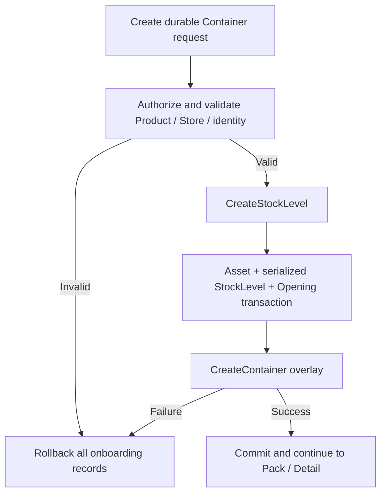

### Existing Asset to Container workflow (implemented)

H1.2 does not replace the scan-to-create path for an already existing
serialized housing Asset:

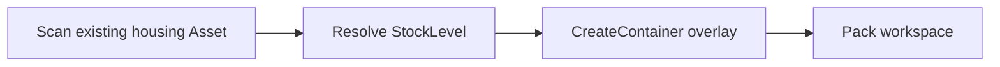

Use the durable onboarding page for a new physical housing identity. Use
the existing scan flow when the serialized Asset and StockLevel already
exist.

### Durable versus temporary Containers

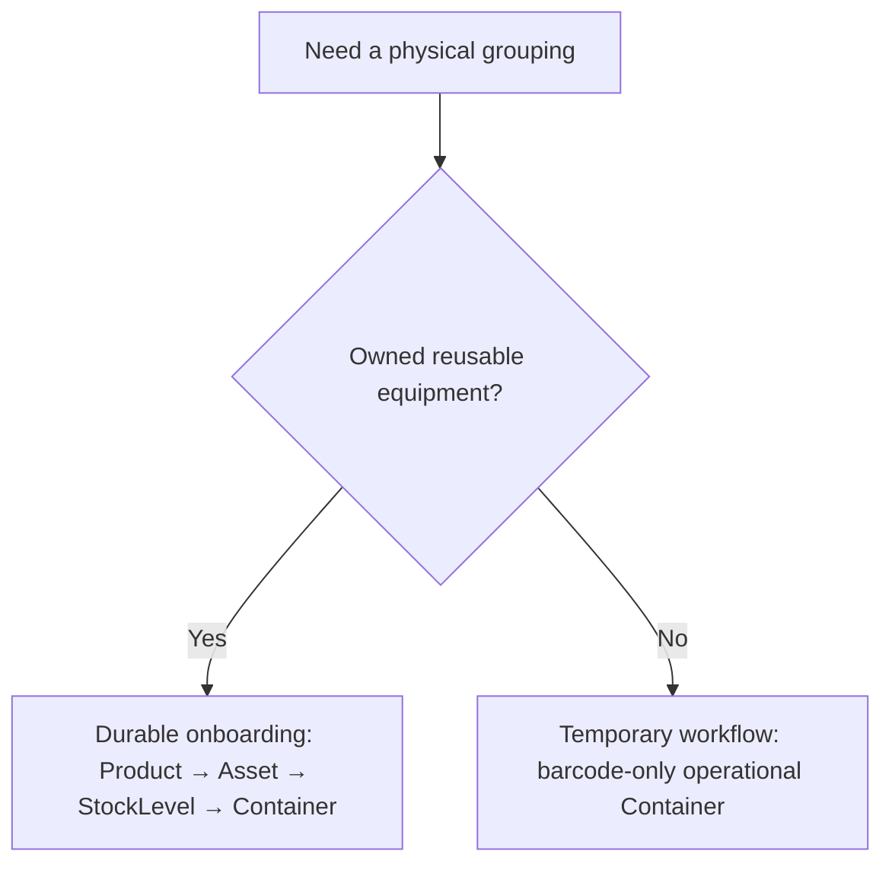

Temporary Container creation remains a separate workflow through
`CreateTemporaryContainer`. H1.2 does not merge the two semantics or add
bulk containment.

### AV examples

For a new XLR flightcase:

```text
Product:      Standard XLR Flightcase
Store:        Thessaloniki
Asset Number: FC-001
Barcode:      FC-XLR-001
Name:         XLR CASE 01

Product
└── Asset FC-001
    └── serialized StockLevel, quantity_held = 1
        ├── Opening StockTransaction
        └── Container "XLR CASE 01"
```

The Opening transaction is created by canonical serialized StockLevel
creation. Container onboarding adds the housing overlay and does not emit
a second StockTransaction.

For an M32 case, selecting `M32 Flightcase`, entering asset number
`CASE-M32-001`, and naming it `FOH M32 Case` creates the physical case
identity only. It does not create the M32 console or any ContainerItem
contents. Packing remains a separate workflow.

### Future / proposed behavior

The following remain future work and are intentionally not implied by the
H1.2 page:

- bulk Pack/Unpack/Move workflows and split-quantity operations;
- Container manifest reconciliation;
- automatic stocktake interpretation;
- Store/Warehouse redesign;
- cross-namespace global identifier migration;
- H2.2 operation workflows and later availability integration.

## H2.1 — Bulk containment foundation (implemented)

H2.1 adds persistence for current bulk containment and immutable bulk
containment history. It does not add Pack, Unpack, Move, Correction, manifest,
availability, stocktake, or reconciliation workflows.

Bulk containment must reference the exact bulk `StockLevel`, not merely a
Product. One StockLevel may be split across multiple Containers:

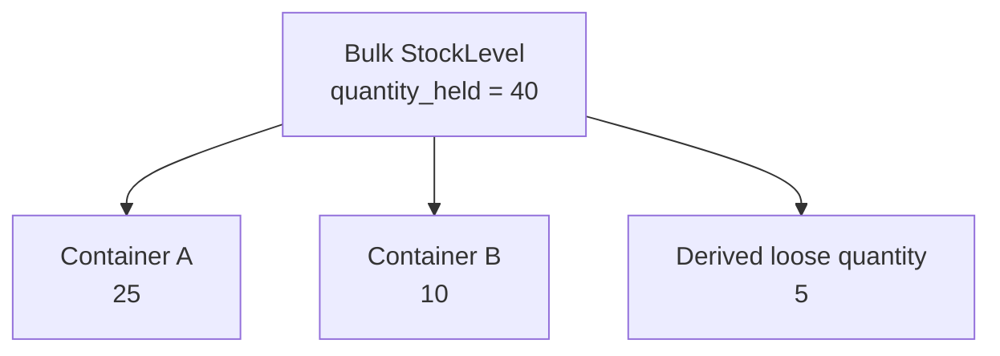

The implemented H2.1 authority boundary is:

```text
Owned quantity
└── StockTransaction + StockLevel.quantity_held

Serialized containment
└── ContainerItem + StockLevel.container_stock_level_id projection

Bulk current containment
└── ContainerBulkMembership (current-state authority)

Bulk containment history
└── ContainerBulkMembershipEvent (immutable audit history)

Loose quantity
└── StockLevel.quantity_held - SUM(active bulk memberships)
```

`ContainerBulkMembership` is the sole authority for current bulk containment.
Its quantity is intended to be changed only by future explicit H2 Actions.
`ContainerBulkMembershipEvent` is immutable history, not a second stock ledger
and not a second current-state authority. Ordinary reads never replay events.

Pack, unpack, and move would never create a `StockTransaction` or change
`quantity_held`. Every operation would lock the exact bulk StockLevel, verify
that the resulting active membership sum does not exceed `quantity_held`, and
then update the membership projection and append history in one transaction.

The proposed operation flow is:

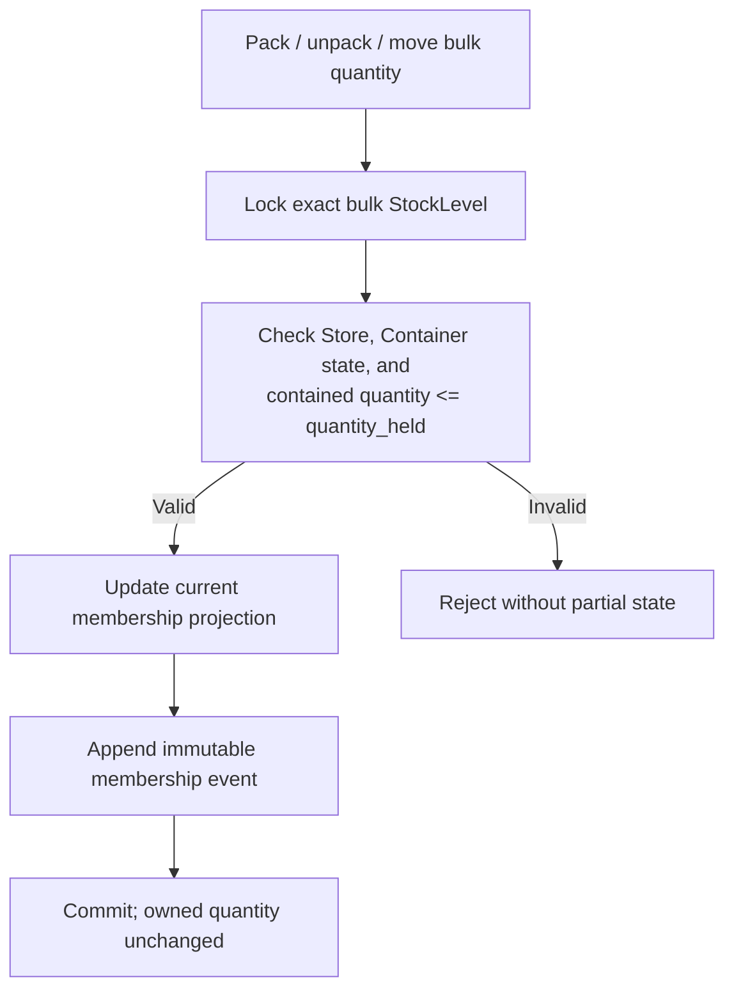

The implemented history model is hybrid current-state-plus-history, not
immutable temporal segments. H2.1 establishes the tables, relationships,
eligibility checks, database constraints, and quantity-floor integration; the
operation Actions remain future work.

### Implemented H2.1 invariants

- A membership references exactly one Container and one bulk StockLevel.
- Current membership quantity is positive.
- There is at most one current membership for a Container + StockLevel pair.
- The same bulk StockLevel may have memberships in multiple Containers.
- Loose quantity is derived and is never stored as an independent balance.
- The sum of current memberships cannot exceed `StockLevel.quantity_held`.
- Durable and temporary Containers may both hold bulk groupings, subject to
  the same Store and lifecycle rules; temporary Containers do not gain a
  Product template or availability semantics from this capability.
- A Container and bulk StockLevel must belong to the same Store for packing.
- Zero-quantity membership rows are not valid current rows. Future Unpack
  Actions must remove the row and append history in one transaction.
- A quantity decrease is rejected centrally when its resulting
  `quantity_held` would be below current contained quantity. The exact
  StockLevel row is locked before this check.

### H2.1 quantity authority and floor

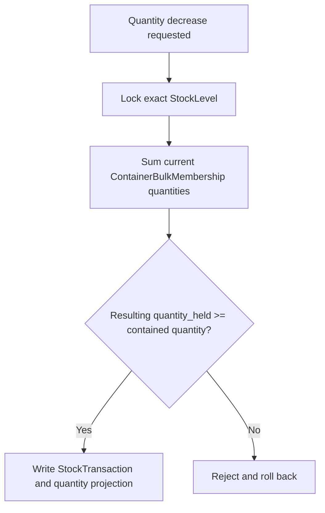

For example, an XLR 10m bulk StockLevel with `quantity_held = 40` can have
25 units in Case A and 10 in Case B. The persisted memberships total 35 and
the derived loose quantity is 5. A decrease of 5 is allowed; a decrease of 6
is rejected. Memberships are never silently changed by a stock adjustment.

### Proposed future workflow names

```text
PackBulkContainerStock
UnpackBulkContainerStock
MoveBulkContainerStock
CorrectBulkContainerMembership
```

These Actions are proposed only. They must own authorization, locking,
membership mutation, and history creation synchronously. Model observers must
not enforce the core invariant.

### Explicit future boundaries

- H3 decides whether contained bulk is available, unavailable, or affected by
  the Container's availability mode.
- H5 stocktake may display expected bulk manifests but must not treat scanning
  a Container as physical verification of every item.
- D6 reconciles manifest differences and does not silently alter H2 history.
- D4 Store transfers must define how Containers and bulk memberships move
  together before cross-Store operations are allowed.
