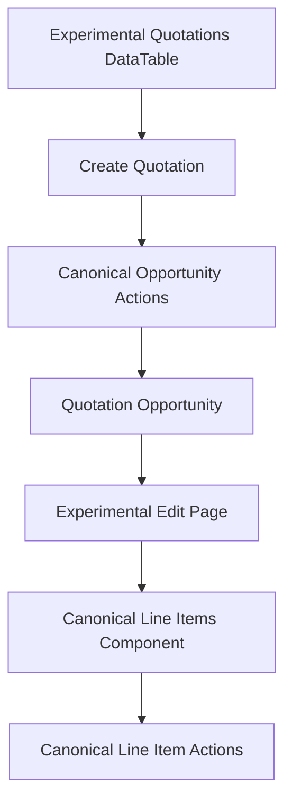
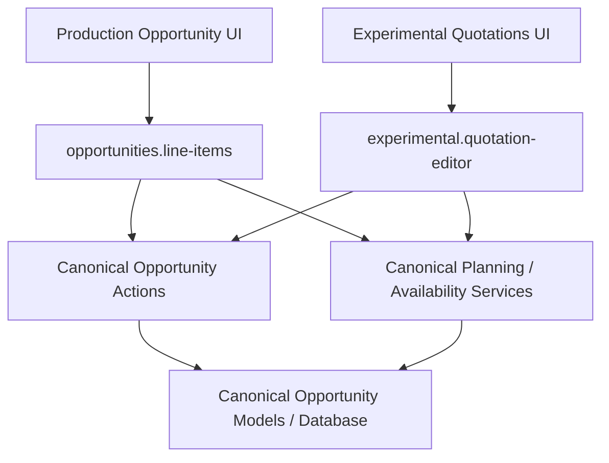
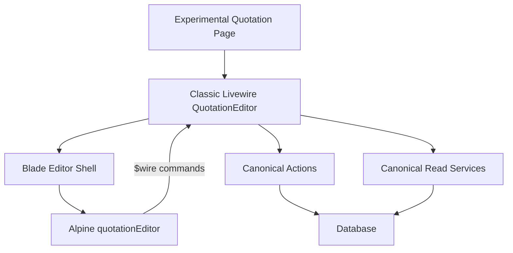

# Experimental Area

## Purpose

Experimental is an isolated UI/workflow evaluation area inside Signals. It tests
alternative page composition and interaction patterns using the real Signals domain.

It is not a second domain, fake-data layer, second database, or permission bypass.

```text
Experimental presentation
        |
        v
Canonical Actions / Models / Services
        |
        v
Canonical database
```

## Current / Implemented

The first workspace is Experimental → Quotations:

```text
routes/experimental.php

/experimental
└── quotations
    ├── /
    ├── /create
    └── /{opportunity}/edit
```

Quotation rows are canonical `Opportunity` records filtered to the `Quotation` state.
Creation uses `CreateOpportunity` followed by `ConvertToQuotation`. Editing uses
`UpdateOpportunity`, and the editor embeds the isolated Experimental quotation editor
forked from the production line-items component.



The workspace is protected by the existing authenticated application middleware and
the existing Opportunity permissions. Closed and pricing-frozen behavior remains
owned by the canonical domain actions and line-items component.

## Data and lifecycle boundary

Experimental changes presentation and workflow composition only. It does not create:

- an Experimental Quotation model;
- Experimental tables or a second database;
- duplicate line-item, availability, pricing, or shortage logic;
- new API behavior.

The quotation edit page receives only the canonical `Opportunity` route model. Line-item
products, stock, Demand, planning, and shortage behavior remain inside the canonical
component and its existing read architecture.

## Experimental Quotation Editor

Status: CURRENT / IMPLEMENTED

Production Opportunities continue to use `opportunities.line-items`. Experimental
Quotations use the independently editable `experimental.quotation-editor` component.
The two components intentionally duplicate presentation and component orchestration so
quotation-specific UI experiments cannot destabilize the production editor. Both use
the canonical Opportunity Actions, models, planning, availability, stock, Demand, and
shortage services. No domain behavior is forked.



The editor technical boundary is:



`QuotationEditor` is a classic Livewire component at
`app/Livewire/Experimental/QuotationEditor.php`. Its Blade view is split only at
semantic surface boundaries (`toolbar`, `grid`, `overlays`, and `modals`). Rows remain
Blade fragments inside one editor lifecycle; they are not nested Livewire components.

Alpine owns transient grid state such as focus, selection, drag/drop, keyboard
navigation, optimistic rows, and local modal state. Livewire remains the command gateway
and canonical snapshot boundary, while the database remains persisted authority.

Nested Livewire is reserved for coarse independent surfaces such as activity, files,
comments, or audit history. Product rows, section rows, and cells do not become nested
components because that would complicate unified tree state and add hydration overhead.

Future quotation-specific UI work should target `experimental.quotation-editor` unless
promotion to the production editor is explicitly requested.

## Quotation Editor Sorting

Status: CURRENT / IMPLEMENTED

The Experimental quotation editor uses the same pointer-based flat-tree drag behavior as
the production line-items editor. Alpine Sort is not used on this tree surface. It is
kept out because this editor renders a logical tree as a flat table and the production
algorithm explicitly interprets reorder, nest, and unnest intent.

```text
tree-drag.js
    = pointer interaction, ghost, placeholder, and drop-target calculation

QuotationEditor Alpine module
    = applies the completed drag result and queues the existing persistTree command

Livewire QuotationEditor
    = canonical command, validation, and revision boundary

Opportunity Actions / tree services
    = domain persistence and tree invariants
```

Only the dedicated drag handle starts a drag. The current tree model remains flat in the
browser with depth metadata, while `resolveDropTarget()` determines the intended depth
and parent. Group blocks move together, and invalid destinations are rejected without
changing the persisted tree.

This is Experimental-only sorting infrastructure. The production
`opportunities.line-items` editor remains on its existing drag/drop implementation.

