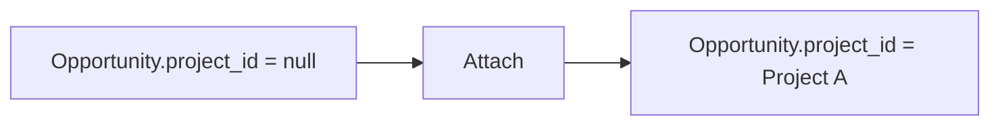
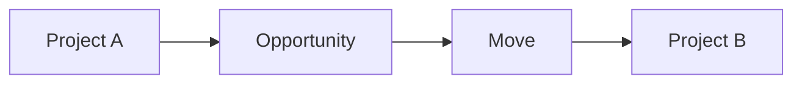
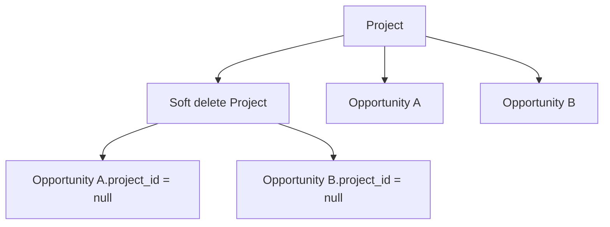
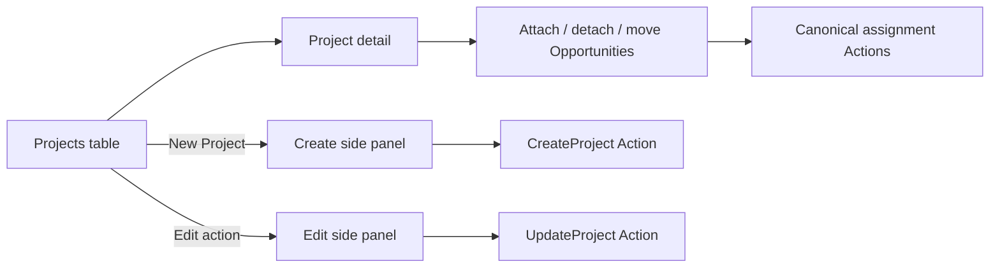

# Projects

## Status

The first Project foundation is **CURRENT / IMPLEMENTED**. A Project groups
existing Opportunities (quotes and orders) without becoming an inventory,
Store, availability, or accounting scope.

The following remain **FUTURE / DEFERRED**: Project Groups, crew planning,
logistics planning, project documents, activity feeds, and persisted financial
rollups.

## Domain model

The application uses `Opportunity` as the rental/job aggregate. A Project has
no `store_id`; each Opportunity keeps its own Store, dates, availability, and
financial projection.

```text
Project
├── Customer (optional Member: Organisation)
├── Venue (optional Member: Venue)
├── Owner (optional Member: User)
└── Opportunities
    ├── Opportunity A -> Store A
    ├── Opportunity B -> Store B
    └── Opportunity C -> Store A
```

The database relationship is one-to-many:

```text
projects.id
    │
    └── opportunities.project_id (nullable)
```

An Opportunity can belong to at most one Project. Project Groups are not part
of this implementation.

## Lifecycle

Projects use the `ProjectStatus` enum:

| Status | Meaning |
| --- | --- |
| Draft | Planning record not yet active |
| Active | Current engagement |
| Completed | Engagement finished |
| Archived | Retained for history and excluded from active work |

Allowed transitions are `Draft -> Active`, `Draft -> Archived`,
`Active -> Completed`, `Active -> Archived`, and `Completed -> Archived`.
Project dates are planning metadata. They never replace the operational dates
on an Opportunity and do not directly drive availability.

## Assignment semantics

Assignment is explicit and transactional:



`AttachOpportunityToProject` accepts an unassigned Opportunity and is
idempotent when it is already attached to the same Project. It rejects an
Opportunity assigned to a different Project; it never silently reassigns it.

Moving is a separate operation:



`MoveOpportunityToProject` explicitly changes the assignment after checking
the current source Project and destination permissions. Detaching clears
`project_id` and never deletes the Opportunity. Repeated detach is harmless
when the Opportunity is already unassigned.

## Deletion

Deleting a Project soft-deletes the Project and clears `project_id` on its
linked Opportunities in the same transaction. The Opportunities remain
available and retain their own Store and operational history.



## Authorization and API

Web and API access use the existing permission conventions:

- `projects.view`
- `projects.create`
- `projects.edit`
- `projects.delete`

Project write permission governs metadata changes and assignment operations,
while the underlying Opportunity policy still applies to the Opportunity.
The API also exposes `projects:read` and `projects:write` token abilities and
uses the existing resource/action conventions.

Implemented API operations are Project CRUD plus explicit attach, detach, and
move Opportunity actions under `/api/v1/projects`.

## Operator workflow

Project browsing is a compact DataTable with server-backed archive scopes
(Active, Archived, and All), URL state, search, sorting, pagination, customer,
venue, status, planning dates, owner, and Opportunity count. Row actions use
the shared DataTable action menu. Creating and editing a
Project uses the in-context Dense side panel from the Projects list; the list
remains visible and the panel pushes the working area rather than covering it.
The panel uses the same canonical `CreateProject` and `UpdateProject` Actions
as the API. Validation failures remain in the panel so entered values can be
corrected without losing list context.

The Project detail page prioritizes status and grouped Opportunities. Attach,
detach, and move remain explicit actions on that page and continue to use
`AttachOpportunityToProject`, `DetachOpportunityFromProject`, and
`MoveOpportunityToProject`. Detach is confirmed by the operator; attachment
conflicts and invalid assignments are reported without silently overwriting
another Project.



The legacy named create/edit URLs remain as compatibility entry points and
redirect to the Projects list with the appropriate side panel open. They are
not separate operational workspaces.

## Concurrency

Attach, detach, move, and deletion lock the exact Opportunity row before
validating and applying the assignment. This prevents competing requests from
performing an unsafe read-then-write reassignment. Project deletion locks its
linked Opportunities in deterministic ID order.

## Financial rollups

No financial values are duplicated on `projects`. A future summary must use
the existing canonical Opportunity/invoice calculators. Persisted revenue,
cost, margin, or profit fields are intentionally deferred.
